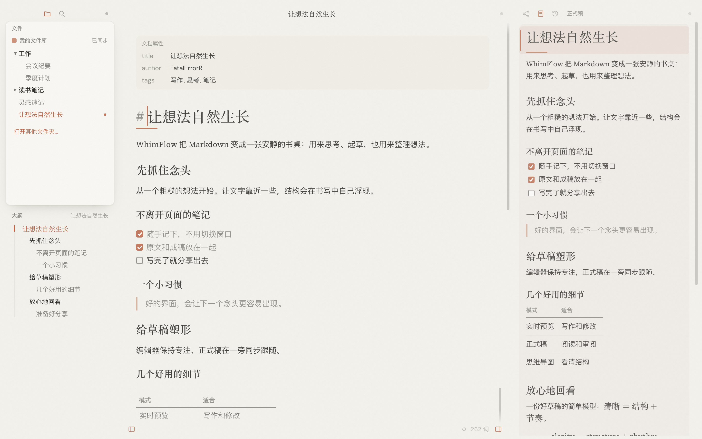
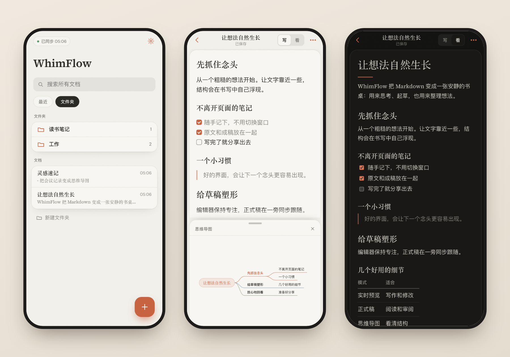

<div align="center">
  
  <h1>WhimFlow</h1>
  <p>A calm, live-preview Markdown workspace for thinking, drafting, and organizing ideas.</p>
  <p>
    <a href="https://github.com/FatalErrorR/WhimFlow/releases/latest">Download the latest release</a>
    ·
    <a href="https://github.com/FatalErrorR/WhimFlow/issues">Report an issue</a>
    ·
    <a href="#中文说明">中文说明</a>
  </p>
</div>



WhimFlow is a Markdown editor for macOS, Windows, iPhone and iPad, built with Electron, Capacitor and CodeMirror 6. Writing, structure and the rendered page stay side by side, and your library follows you from the Mac to the phone through a small sync server you run yourself.

## Highlights

- Live Markdown editing with a focused, distraction-free layout
- A final view that follows as you type, and a mind map of the headings
- Tables, task lists, footnotes, front matter, code blocks with highlighting, images, KaTeX math and Mermaid diagrams
- **My Library**: a folder that lives in the app, always on top of the sidebar, synced with your own server
- Drag documents, images or whole folders from Finder into the library: they are copied in, with the images they show
- Multiple documents, folder search, version history, crash recovery, and export to PDF, HTML, Word and PNG
- An iPhone and iPad app (iOS 16.4+) with the same editor: write / read, the mind map under the text, pull down to sync, swipe a file to rename, move or delete it

## Preview

The mind map opens beside the text when you want to see the whole structure; a node takes you to its section:


On the iPhone: the synced library, writing with the mind map underneath, and reading in the dark theme:



## Download

Prebuilt installers are published on the [Releases](https://github.com/FatalErrorR/WhimFlow/releases) page.

| Platform | Packages |
| --- | --- |
| macOS | `.dmg` and `.zip` for Apple Silicon and Intel |
| Windows | `.exe` installer and `.zip` portable package for x64 |

The current builds are unsigned. macOS and Windows may show a first-run security warning until the application is signed with platform certificates. The iPhone app is built from source (see below).

## Sync

Every device keeps a full copy of the library, so it opens instantly and works offline; a small server you host keeps the shared copy, and the devices sync through it.

- **On the Mac** the library is in the app's own folder (`~/Library/Application Support/WhimFlow/Documents`) and is always shown at the top of the sidebar. Other folders you open appear below it.
- **On the iPhone** it is the app's folder, also visible in the Files app.
- A device syncs when it starts, a moment after you save, every minute, and when it comes to the front; on the iPhone you can also pull the library down.
- Nothing is silently overwritten: every write names the version it replaces. If two devices changed the same document, both versions are kept, the other one as `name (冲突 <device> <time>).md`. An edit beats a delete.
- Deleted files go to a trash folder, on the devices and on the server. The first sync only adds, and a device whose library is suddenly empty does not empty the server.
- Hidden files, temporary files and the app's drafts and history stay on the device.

### Run the sync server

The server (`sync-server/`) is a single dependency-free Node file. On a Linux host with Docker:

```bash
# on the server
mkdir -p /opt/whimflow-sync && cd /opt/whimflow-sync
# copy sync-server/server.js, Dockerfile and docker-compose.yml here, then:
mkdir -p data backups && chown 1000:1000 data
umask 077 && printf 'WHIMFLOW_TOKEN=%s\n' "$(openssl rand -hex 32)" > .env
docker compose up -d --build
```

It listens on `127.0.0.1:8790` only. Put it behind HTTPS: `sync-server/nginx-site.conf` is an nginx site for it (replace the host name, get a certificate with certbot), and `sync-server/backup.cron` keeps a nightly copy of the data for 14 days. Keep `.env` private: the token is the key to your notes.

Then, on each device: **Settings → Sync**, enter the server address and the token, and connect. The token is stored in the system keychain (Keychain on macOS and iOS).

## Run from source

Requirements: Node.js 20 or newer.

```bash
npm ci
npm start
```

## Build installers

```bash
# macOS: Apple Silicon and Intel
npm run dist:mac

# Windows: x64 installer and portable ZIP
npm run dist:win
```

Build output is written to `dist/`. Release artifacts are kept out of Git by `.gitignore` and uploaded to GitHub Releases instead.

## iPhone and iPad

The iOS app lives in `mobile/` (Capacitor) and shares the desktop interface code: editor, final view, mind map, highlighting, conflict detection and sync. Documents are stored in the app's own folder, visible in the Files app under *On My iPhone › WhimFlow*. Requires iOS / iPadOS 16.4 or newer.

On a Mac with Xcode:

```bash
# install the iOS dependencies once
cd mobile && npm ci && cd ..

# build the web app and sync it into the Xcode project
npm run build:mobile

# open in Xcode, pick a simulator or device, and run
cd mobile && npx cap open ios
```

To run on a real device or publish, choose your Apple developer team under *Signing & Capabilities* in Xcode.

## Tests

```bash
npm test
```

| Command | What it runs | Windows on screen |
| --- | --- | --- |
| `npm run test:unit` | file operations, recovery, search, importing files, closing and quitting | none |
| `npm run test:sync` | the sync server, the sync engine between two devices, the desktop's sync on real folders | none |
| `npm run test:mobile` | the iPhone and iPad app in headless Chromium, including sync against a local server | none |
| `npm test` | all of the above plus the desktop end-to-end tests (Playwright driving Electron) | yes |

The desktop end-to-end tests can run without showing anything: `WHIMFLOW_HIDDEN=1 npm test` draws the windows but never shows them, and hides the Dock icon. All tests read and write only in the system's temporary folder.

The README screenshots are made the same way, without anything on screen: `npm run screenshots`.

## Project layout

| Path | Purpose |
| --- | --- |
| `src/main.js`, `src/main/` | Electron main process: windows, files, history, recovery, search, export, importing, closing and quitting |
| `src/main/sync-local.js`, `src/main/sync-desktop.js` | The desktop's side of sync: the library folder, the keychain |
| `src/shared/sync.js` | The sync engine and its controller, shared by the desktop and the iPhone |
| `src/preload.js` | Secure bridge between the main process and the renderer |
| `src/renderer/` | Editor, live preview, final view, mind map, panels, themes, and UI behavior |
| `src/renderer/js/mobile/`, `src/renderer/js/platform/` | iPhone / iPad interface and the Capacitor-backed file API |
| `mobile/` | Capacitor project and Xcode workspace for iOS |
| `sync-server/` | The sync server, its Docker files, an nginx site and a backup job |
| `scripts/build.js` | Builds the renderer bundle (desktop, or `mobile` for iOS) |
| `scripts/screenshots.js` | Makes the README screenshots |
| `docs/` | Markdown reference material |
| `test/` | Automated tests |
| `build/` | Application artwork and platform icons |

## 中文说明

WhimFlow 是一个所见即所得的 Markdown 编辑器，有 Mac、Windows、iPhone 和 iPad 版。编辑区、正式稿（渲染后的样子）和思维导图并排显示，写作时结构一目了然。

**主要功能**

- 实时预览编辑，正式稿跟着输入同步刷新；标题自动生成大纲和思维导图
- 表格、待办、脚注、文档属性（front matter）、代码高亮、图片、KaTeX 公式、Mermaid 图表
- **我的文件库**：住在应用里的文件夹，常驻在侧栏最上方，通过你自己的服务器在 Mac 和 iPhone 之间同步
- 从访达把文档、图片或整个文件夹拖进文件库，会复制进来（连同文档里引用的图片），原文件不动
- 多文档、文件夹搜索、历史版本、崩溃恢复，导出 PDF、HTML、Word、PNG
- iPhone / iPad 版：写 / 看两种模式，思维导图在正文下方，下拉同步，左滑文件可以改名、移到文件夹、删除

**同步怎么工作**

每台设备都有一份完整的文件库，打开快、离线也能写；服务器保存共享的那一份，设备之间都通过它同步。同一篇文档在两台设备上都改过时，两份都会保留（另一份的文件名里带「冲突」）；删除的文件进回收站，不会直接抹掉。

**自建同步服务器**：见上面的「Run the sync server」。服务器只需要 Docker；生成一个令牌放进 `.env`，用 nginx 加上 HTTPS。然后在每台设备的「设置 → 同步」里填服务器地址和令牌即可，令牌保存在系统钥匙串里。

**换行和缩进**：编辑区按一次回车，正式稿里也换行；需要严格的 Markdown（单个回车连成一行），在「设置 → 编辑 → 正文区不换行」里打开。用空格或 Tab 缩进的行就是普通文字，缩进会保留；代码块请用 ```。

## Fonts and third-party notices

The application includes Source Serif 4, DM Sans, and JetBrains Mono. Their license files are kept in `src/renderer/fonts/`.

## License

WhimFlow is licensed under the [Apache License 2.0](LICENSE).
