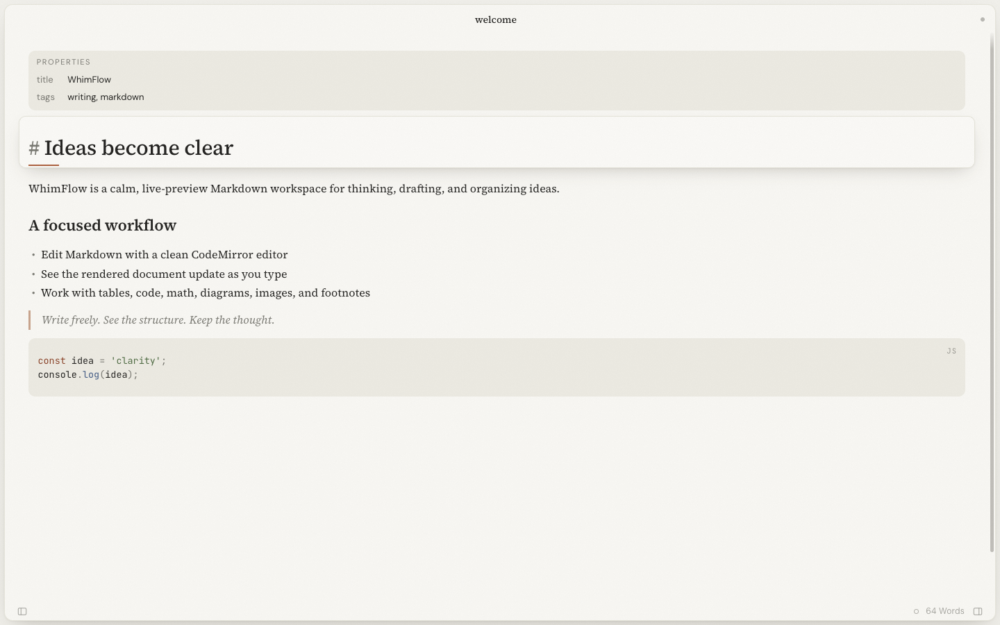
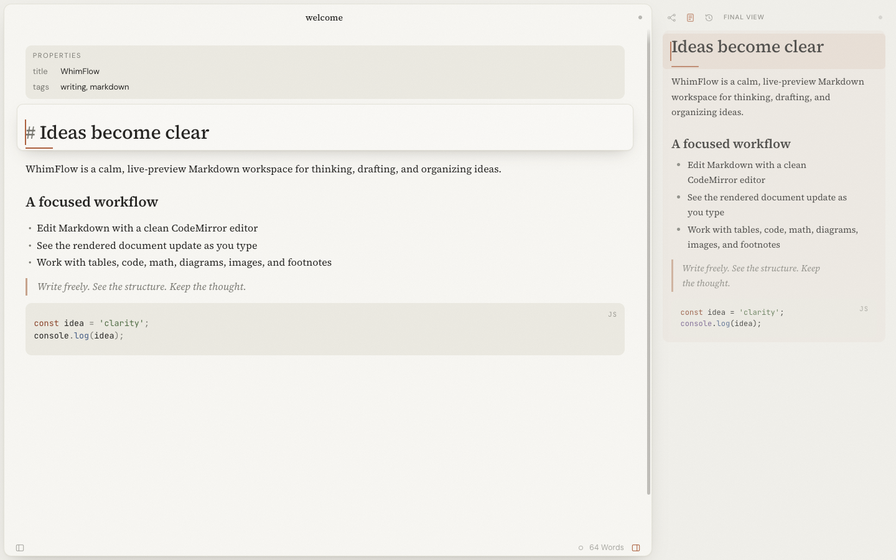

<div align="center">
  
  <h1>WhimFlow</h1>
  <p>A calm, live-preview Markdown workspace for thinking, drafting, and organizing ideas.</p>
  <p>
    <a href="https://github.com/FatalErrorR/WhimFlow/releases/latest">Download the latest release</a>
    ·
    <a href="https://github.com/FatalErrorR/WhimFlow/issues">Report an issue</a>
  </p>
</div>



WhimFlow is a desktop Markdown editor built with Electron and CodeMirror 6. It keeps writing, structure, and rendered output close together so you can focus on the document instead of the tooling around it.

## Highlights

- Live Markdown editing with a focused, distraction-free layout
- Editor and final view that stay in sync while you type
- Tables, task lists, footnotes, code blocks, syntax highlighting, and images
- KaTeX math and Mermaid diagrams
- Multiple documents, search, history, recovery, and export tools
- Native file associations for Markdown documents
- macOS and Windows desktop builds

## Preview

The final view can sit beside the editor while you write:



## Download

Prebuilt installers are published on the [Releases](https://github.com/FatalErrorR/WhimFlow/releases) page.

| Platform | Packages |
| --- | --- |
| macOS | `.dmg` and `.zip` for Apple Silicon and Intel |
| Windows | `.exe` installer and `.zip` portable package for x64 |

The current builds are unsigned. macOS and Windows may show a first-run security warning until the application is signed with platform certificates.

## Run from source

Requirements: Node.js 20 or newer.

```bash
npm ci
npm start
```

## Build installers

```bash
# macOS: Apple Silicon and Intel
npm run dist:mac

# Windows: x64 installer and portable ZIP
npm run dist:win
```

Build output is written to `dist/`. Release artifacts are kept out of Git by `.gitignore` and uploaded to GitHub Releases instead.

## Tests

```bash
npm test
```

The test suite covers editor behavior, rendering, document safety, recovery, preview synchronization, and layout checks.

## Project layout

| Path | Purpose |
| --- | --- |
| `src/main.js`, `src/main/` | Electron main process, file operations, history, recovery, search, and export |
| `src/preload.js` | Secure bridge between the main process and the renderer |
| `src/renderer/` | Editor, live preview, panels, themes, and UI behavior |
| `scripts/build.js` | Builds the renderer bundle |
| `docs/` | Markdown reference material |
| `test/` | Automated tests |
| `build/` | Application artwork and platform icons |

## Fonts and third-party notices

The application includes Source Serif 4, DM Sans, and JetBrains Mono. Their license files are kept in `src/renderer/fonts/`.

## License

WhimFlow is licensed under the [Apache License 2.0](LICENSE).
