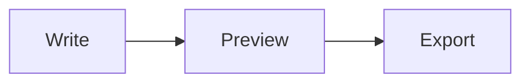

# Markdown Reference

[toc]

WhimFlow renders Markdown **as you type**. Move the caret into any element to reveal and edit its source.

## Headings

`# H1` … `###### H6`, or press <kbd>⌘1</kbd>–<kbd>⌘6</kbd>. <kbd>⌘0</kbd> turns a heading back into a paragraph.

## Inline styles

| Style | Syntax | Shortcut |
| --- | --- | --- |
| **Strong** | `**text**` | ⌘B |
| *Emphasis* | `*text*` | ⌘I |
| <u>Underline</u> | `<u>text</u>` | ⌘U |
| ~~Strike~~ | `~~text~~` | ⌃⇧` |
| `Code` | `` `code` `` | ⌃` |
| ==Highlight== | `==text==` | ⇧⌘H |
| [Link](https://commonmark.org) | `[text](url)` | ⌘K |

Hold <kbd>⌘</kbd> and click a link to open it.

## Lists

- Unordered item
- Another item
  1. Nested ordered item
  2. Second

* [x] Finished task
* [ ] Open task

## Quote

> Simplicity is the ultimate sophistication.

## Code

```js
function greet(name) {
  return `Hello, ${name}!`;
}
```

## Math

Inline $e^{i\pi} + 1 = 0$ and block:

$$
\int_{-\infty}^{\infty} e^{-x^2}\,dx = \sqrt{\pi}
$$

## Diagram



## Footnote

Here is a statement with a footnote.[^1]

[^1]: The footnote text.

---

Use **View → Source Code Mode** (<kbd>⌘/</kbd>) to edit raw Markdown.
